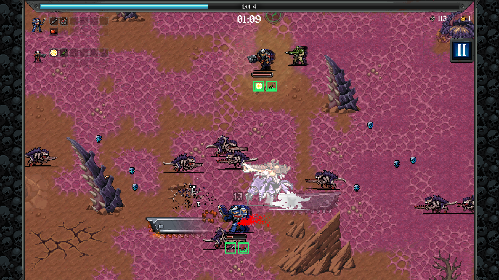
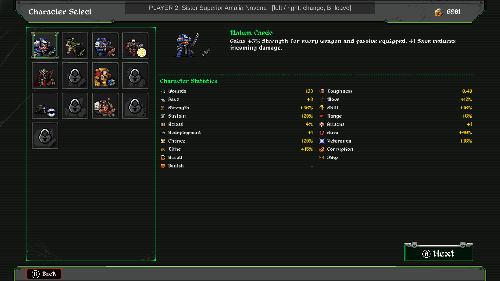
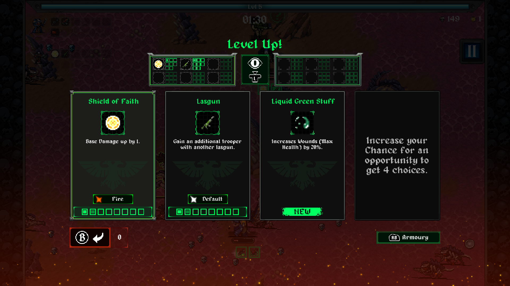
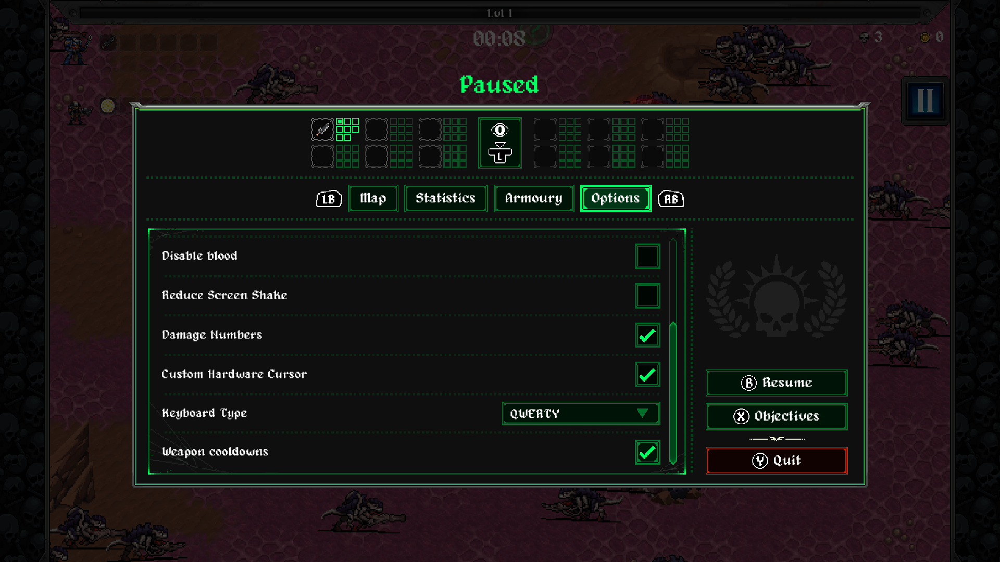

# Warhammer Survivors local coop

A BepInEx 6 plugin that enables the hidden shared-screen cooperative mode of Warhammer Survivors for two local players.

This mod is not an official product. The mod has no connection to Games Workshop, to the developer of the game, or to the publisher of the game.
You must own the game to use the mod.

The game uses the code of Vampire Survivors. The session code still supports more players. This plugin adds the parts that are missing:

- The join step and the character choice for player 2 on the character select page.
- The move of the second controller from player 1 to player 2, with the controller maps for the menus.
- A patch for the level-up page, which throws an exception when a run has more than one player.
- A replacement for the pass action on the level-up page, which throws an exception in the game.
- A correction of the heads-up display, which puts the equipment panels of all players in the same position.

The plugin also shows the weapon cooldown panel of the game for all weapons. This function is independent of the cooperative mode.

## Screenshots

| Character select page with player 2 | Level-up page with the pass button |
| --- | --- |
|  |  |

| Options page with the tick box "Weapon cooldowns" | Equipment panels and cooldown panels of two players |
| --- | --- |
|  |  |

## Status

Tested on Linux with Proton and two virtual Xbox controllers, game build 26581996:

- Player 2 joins on the character select page and selects a character.
- The run starts with two characters on one shared camera.
- Each controller moves only its own character.
- Each player confirms its own level-up.
- The run continues when one player is dead. The game over comes when all players are dead.

- The heads-up display shows one equipment panel for each player.
- Player 2 stays in the session after a run.
- A player passes a level-up to the other player with the pass button. The other player then selects an item.

Known limits:

- The automatic test covered one pass, from player 1 to player 2, at the first level-up.
- A character flashes red while enemies hit it. The game does this, not the mod.

## Pass of a level-up

The level-up page shows the pass button when a different player can use one of the offered items. The button shows its controller button.

The game permits a pass only if the player has the Skip power-up, and a pass costs one Skip. The mod removes this condition by default. Set `FreePass = false` in `BepInEx/config/local.warhammersurvivors.coop.cfg` to get the rule of the game.

## Weapon cooldown panel

The game contains a panel that shows the cooldown of a weapon. The game shows it only for weapons that set the flag `showCooldown` in their data. The mod sets this flag for all weapons.

The options page of the pause menu has the tick box "Weapon cooldowns". Clear the tick box to hide the panel. The mod saves the value as `ShowWeaponCooldowns` in `BepInEx/config/local.warhammersurvivors.coop.cfg`.

## Rules of the game for equipment

The cooperative configuration of the game has these values:

- Each player has an own set of weapons and passive items. The level-up of a player gives the item to that player only.
- The game does not offer a weapon or a passive item to a player if a different player owns it.
- A passive item of one player counts for the weapon evolutions of all players.
- The level and the experience are common to all players.

## Windows

Download the archive `WarhammerSurvivorsCoop-<version>-windows.zip` from the releases of this repository.
Unzip it into the game folder. The archive contains its own instructions.

`./package.sh` makes this archive in `dist/`.

## Install on Linux

The script expects Linux, Steam with Proton, and Nix for the .NET SDK.

1. Start the game one time without the mod, so that Steam creates the Proton prefix.
2. Set `STEAM_LIBRARY` to the Steam library that contains the game. The default is `~/.local/share/Steam`.
3. Run `./install.sh`.
4. Start the game from Steam. The first start takes some minutes.

`./install.sh --uninstall` removes BepInEx and the plugin from the game.

## Build references

The folder `lib/` is not in the repository, because it contains assemblies that BepInEx generates from the game.

1. Unzip the BepInEx archive from `vendor/` into the game folder.
2. Add the `winhttp` override. See `install.sh`.
3. Start the game one time.
4. Copy `BepInEx/interop/*.dll` from the game folder to `lib/interop/`.
5. Copy `BepInEx/core/*.dll` from the game folder to `lib/bepinex-core/`.

## Use

1. Open the character select page.
2. Press a button on a second controller. Do not use B.
3. Move the stick or the D-pad of player 2 to the left or to the right to change the character. Press B to leave.
4. Select the character of player 1 and start the run.

If player 1 uses the keyboard and only one controller is available, set `KeyboardForPlayerOne = true` in `BepInEx/config/local.warhammersurvivors.coop.cfg`.

## Contributions

Open an issue for a bug report. Include the game build and the file `BepInEx/LogOutput.log`.
Pull requests are welcome.

## License

The source code of the mod has the MIT License. See [LICENSE](LICENSE).

The repository and the Windows archive contain a copy of BepInEx, which has a different license. See [THIRD-PARTY-NOTICES.md](THIRD-PARTY-NOTICES.md).
